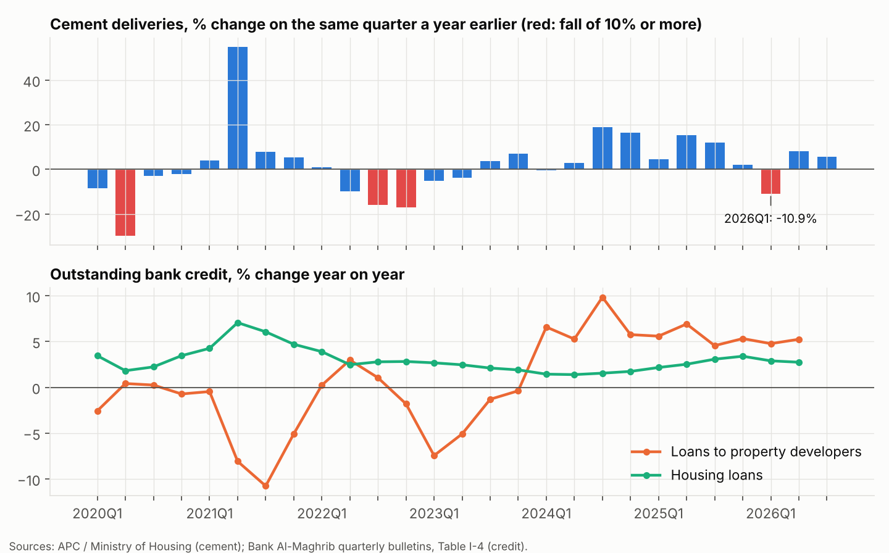
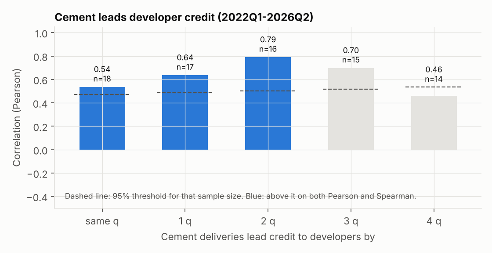

# Morocco real-estate credit signals

**Early-warning signals for property-developer credit risk in Morocco, built entirely from public data.**

An automated pipeline reads Bank Al-Maghrib's quarterly real-estate price index (IPAI) bulletins, checks every value, forecasts the next six quarters and produces risk dashboards. A second module combines the index with bank credit to developers and cement deliveries to flag stress in developer portfolios before it reaches the loan book.

> **Context.** The real-estate market and credit-flow analysis was my personal assignment during my internship in the Counterparty Risk Surveillance department of a Moroccan bank (Aug–Oct 2026). I presented the results to the department director, and I proposed and prototyped the ETL pipeline to automate the analysis. This repository rebuilds that work **from public sources only**: no bank data, systems or internal documents. The credit and cement module was rebuilt after the internship from Bank Al-Maghrib and cement-industry publications.

---

## Key findings

| | Finding |
|---|---|
| **Leading indicator** | Cement deliveries lead credit to property developers by 0–2 quarters (correlation up to 0.79 since 2022, n = 16). Construction activity shows up in cement orders before it reaches banks' developer books. |
| **Early warning, 2026** | Cement deliveries fell **10.9%** year on year in Q1 2026, the only quarter the early-warning rule flags since 2023. They recovered in Q2 (+8.0%) and Q3 (+5.5%). |
| **Concentration** | Loans to developers reached **19.4%** of real-estate credit in Q2 2026, 1.6 standard deviations above the post-2022 average (WATCH). |
| **Price–volume decoupling** | Transaction volumes fell in 5 of the 6 years since 2021 while prices stayed broadly flat, a tension that can resolve through a delayed price correction. |
| **Forecasts** | Simple seasonal models (with AR(1) for land and commercial prices) beat both naive benchmarks on all 8 series in walk-forward backtesting. |

What did **not** hold up is reported too: cement deliveries do not predict transaction volumes, and the price–transaction correlation has no predictive value.

<p align="center">
  
  
</p>

Full report: [`outputs/credit_signals_report.md`](outputs/credit_signals_report.md) · Dashboards: [`outputs/dashboards/IPAI_dashboards.pdf`](outputs/dashboards/IPAI_dashboards.pdf)

## What is inside

**1. IPAI ETL pipeline** (`run_pipeline.py`, `ipai_etl/`)
- **Detect and download:** checks Bank Al-Maghrib's page only inside each quarter's expected publication window, at most 12 polite requests per check, respects robots.txt, and stops cleanly on HTTP 403.
- **Extract:** reads the text tables exactly, and reads transaction counts (which exist only as chart bars) from the PDF's vector geometry, calibrated on the axis labels. Each bulletin's full chart window (about 24 quarters) is used to fill gaps, and those values are labelled as revisions.
- **Check:** completeness, value ranges, a scale cross-check between consecutive bulletins and drift between runs. A diagnostics workbook traces every step.
- **Publish:** a 20-sheet Excel workbook and a long CSV ready for a data mart, with optional authenticated upload to any HTTP API (off by default).

**2. Dashboards and forecasts** (`ipai_viz/`)
- Seven dashboards: overview, market risk, credit-product profile, developer margin and seasonality, retrospective, signals, forecasts. They are exported as PNG, SVG, PDF and a self-contained HTML page, plus CSVs for Tableau.
- Forecasting with interpretable regressions (seasonal, trend and AR(1) variants), selected by walk-forward backtesting against persistence and seasonal-mean benchmarks. Uncertainty bands come from the backtest error at each horizon.

**3. Credit and construction signals** (`src/credit_signals/`)
- A quarterly panel combining the IPAI, monthly outstanding real-estate credit (8 Bank Al-Maghrib bulletins, every vintage kept) and APC cement deliveries.
- Lead/lag correlations (Pearson and Spearman with significance bands), z-score early-warning flags computed without look-ahead, and a developer-margin proxy.

## Quickstart

```bash
git clone https://github.com/ayoubAMEKZAZ1/morocco-real-estate-credit-signals.git
cd morocco-real-estate-credit-signals
pip install -r requirements.txt

python scripts/run_credit_signals.py                       # credit and cement analysis -> outputs/
python -m ipai_viz.build --xlsx data/ipai/IPAI_quarterly_series.xlsx --out outputs/dashboards
pytest                                                     # 8 tests, including an offline end-to-end pipeline run
```

To run the full pipeline on the bulletins, place the IPAI PDFs in `data/pdfs/` and run `python run_pipeline.py run --rebuild`. The end-to-end test does this offline with two sample bulletins, a mock website and a mock API.

## Repository layout

```
run_pipeline.py          pipeline orchestrator (cron-friendly; exit code 2 on quality errors)
config.yaml              schedule, sources, politeness limits, quality thresholds, publishing
ipai_etl/                scraper, PDF extractor, quality checks, outputs, publishing
ipai_viz/                dashboards, forecasting (forecast/), qualitative signals
src/credit_signals/      quarterly panel, lead/lag analysis, early-warning flags, report
data/ipai/               official IPAI rates, transaction counts, reference workbook
data/external/           Bank Al-Maghrib credit series and cement deliveries, with source URLs
outputs/                 report, figures and dashboards generated from the data above
docs/DATA_SOURCES.md     every source, method choice and known data issue
tests/                   unit tests and the offline end-to-end pipeline test
```

## Method choices worth knowing

- **Only official published rates.** Rebuilding an absolute index level by chaining quarterly changes was tested and dropped: Bank Al-Maghrib revises past values in every bulletin, so the chained series drifts away from the published year-on-year figures.
- **Traceability.** Every value can be traced to a bulletin or a URL. Revised values are labelled, and nothing is imputed.
- **Honest validation.** Every forecast and lead/lag result is out-of-sample or reported with its sample size; weak results are kept.

## Limitations

- About 26 quarters is a short sample: the correlations are indicative, not causal estimates.
- IPAI coverage widened to 83 land registries in Q1 2025, so year-on-year comparisons across that break are less reliable.
- Nine of the 31 cement quarter-end figures come from press reports rounded to a few decimals of a million tonnes. Novacim joined the producers' panel in 2024.
- The forecasts read trends; they do not anticipate policy or macroeconomic shocks.

## Author

**Ayoub Amekzaz** · B.Sc. (Hons) Data Science, Cyprus International University · ayoub1am@icloud.com

Data: Bank Al-Maghrib, ANCFCC (national land registry agency), the Moroccan cement producers' association (APC) and Morocco's housing ministry. Code: MIT license.
